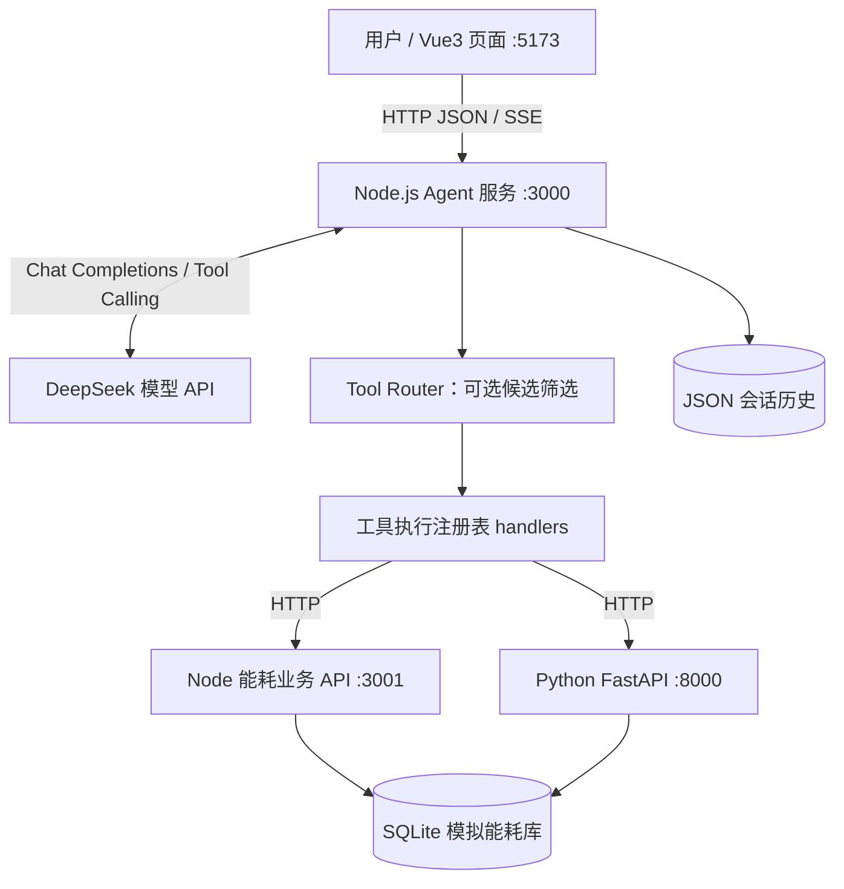

# PROJECT_CONTEXT.md

> **项目名称**：DeepSeek Agent 从零学习与实战（地铁能源管理教学示例）  
> **维护对象**：Leon（Vue3 / JavaScript 前端开发者，了解少量 Python）  
> **上下文整理日期**：2026-11-10  
> **项目实际位置（用户提供）**：`D:\code\Test\AgentStudy\AI-Learning\deepseek-agent`（Windows）  
> **文档性质**：依据本次对话中的课程规划、示例设计、问题反馈和代码讲解整理的交接文档，**不是对用户 Windows 本地仓库的一次代码审计**。

## 阅读前的重要约定

1. 下文的“已学习/已讲解”表示课程已经覆盖、讨论过方案或提供过参考代码；不等于已经在用户电脑上运行、验收或提交到 Git。
2. **业务能源数据均为教学模拟数据**。不得将示例数值、模拟站点或分析结论描述为深圳地铁真实运营数据。
3. 用户明确表示**不会 Java、不会 Spring Boot**，熟悉 Vue 前端，懂一些 Python。因此 Agent 教学主线是 **JavaScript + Node.js + DeepSeek**，补充 **Python + FastAPI**，不以 Java 后端作为课程前置条件。
4. 用户希望理解整个 Agent 工作原理、模块职责、数据流和调试方法；不要求脱离文档“盲写”所有框架语法，但需要能阅读、修改、排错并验证 AI 辅助生成的代码。

## 1. 项目背景与目标

### 1.1 为什么做这个项目

用户本职是前端工程师，正在系统学习如何从普通大模型 API 调用进阶到能调用业务工具、持有对话记忆、查询真实数据库、流式输出、展示执行过程的 AI Agent。

课程选择“地铁能源管理助手”作为贯穿案例，与用户熟悉的深圳地铁 NOCC / EMS 能源管理业务场景有关。典型提问包括：

- “查询 A 站某日用电量。”
- “A 站和 B 站谁的用电量更高？高多少？高百分之几？”
- “分析 A 站两天的用电趋势，有没有异常？”
- “介绍某个车站的基础信息。”

需要明确区分：

| 范围 | 当前定位 |
| --- | --- |
| **DeepSeek Agent 教学项目** | 独立本地练习；Node.js / Vue3 / FastAPI / SQLite；使用模拟能源数据。 |
| **深圳地铁 NOCC / EMS 实际企业项目** | 已讨论的真实业务背景，涉及线网能耗监测、统计、分析，实际技术背景为 Vue3 + Spring Boot，部署方案后来改为 CCE 容器化。**目前没有证据表明两套项目已进行代码或生产数据对接。** |

### 1.2 最终目标

构建一个完整的、可演示和逐步扩展的“地铁能源管理 AI Agent”，使其能够：

1. 通过自然语言理解查询、对比、趋势分析等任务。
2. 根据工具定义自动选择并调用业务工具，而不是编造能耗数据。
3. 使用工具调用循环完成多步骤分析；对强约束流程可用代码工作流保证顺序。
4. 通过 Node.js HTTP 服务、SQLite 数据库及 Python FastAPI 获取数据或计算结果。
5. 维护用户/会话上下文，支持 HTTP / SSE 流式回答。
6. 使用 Vue3 展示聊天文本、工具执行状态和会话历史。
7. 后续集成 RAG 知识库、多 Agent 协作，形成综合作品。

## 2. 当前技术栈

| 层次 | 技术与作用 | 状态说明 |
| --- | --- | --- |
| 前端 | Vue 3、Vite、JavaScript、Composition API | 第 11、12、13、17 节涉及。 |
| 前端流式解析 | 浏览器 `fetch`、`ReadableStream`、`getReader()`、`TextDecoder`、`AbortController` | 展示 SSE 文本/执行事件；17 节进一步封装。 |
| Agent 主服务 | Node.js（教学使用 Node v24.15.0）、内置 `node:http` 和 `fetch` | 教学主线；不依赖 Java/Spring Boot。 |
| 大模型 | DeepSeek Chat Completions API，`https://api.deepseek.com/chat/completions` | 工具调用、流式生成；具体模型名以本地配置为准；示例曾使用 `deepseek-flash`。 |
| 模型鉴权 | 服务端环境变量 `DEEPSEEK_API_KEY` | 密钥不应放在 Vue 前端或提交到仓库。 |
| 数据存储 | JSON 会话历史，SQLite 文件 `data/energy.sqlite` | 前者记录对话；后者保存模拟能耗数据。 |
| Node SQLite | `node:sqlite` 的 `DatabaseSync` | 第 15 节基于较新的 Node 版本。 |
| Python 工具服务 | Python、FastAPI、Uvicorn、标准库 `sqlite3` | 第 16 节，独立端口提供趋势分析。 |
| 接口与协议 | REST / JSON、Server-Sent Events（SSE）、DeepSeek Tool Calling | Node 主服务整合多语言业务接口。 |
| 工具路由 | 简易 JavaScript 关键字 Tool Router | 番外专题 A；实验型候选工具筛选。 |
| 依赖管理 | Node.js/npm，Python `.venv` | Windows 下分别运行。 |

**本项目未确定采用** LangChain、LangGraph、Java、Spring Boot、消息队列或 Kubernetes 作为 Agent 教学依赖。课程的重点是亲自理解底层 Tool Calling 交互，再考虑后续框架化。

## 3. 已完成的学习内容与功能范围

> **状态定义**：“已讲解”仅代表对话中课程已经推进到相应章节；“待复验”代表缺少当前本地源码与完整运行结果证据。“计划中”代表尚未开始对应开发。

| 章节 | 功能与目标 | 已讨论/设计的重点 | 状态 |
| --- | --- | --- | --- |
| 1～3 | Agent 基础 | Node.js 环境、DeepSeek API 调用、Prompt、模型与工具职责 | 已学习；运行状态待复验 |
| 4 | 单工具调用 | `get_station_energy`：调用模拟能源查询函数 | 已讲解；待复验 |
| 5 | 自动选工具 | `get_station_energy`、`get_station_info`，`tool_choice: "auto"` | 已讲解；待复验 |
| 6 | 多步工具调用 | 再加入 `calculate_energy_difference`，模型执行查询→计算→回答的多轮循环 | 已讲解；待复验 |
| 7 | 短期记忆 | CLI `messages` 数组携带上下文 | 已讲解；待复验 |
| 8 | 持久记忆 | `data/chat-history.json` 保存历史 | 已讲解；待复验 |
| 9 | 多用户会话 | 按 `userId`、`sessionId` 保存单独 JSON 历史 | 已讲解；待复验 |
| 10 | Agent HTTP 接口 | `POST /api/agent/chat`，普通 JSON 回答 | 已讲解；待复验 |
| 11 | Vue3 聊天页 | `agent-ui`，发送消息、展示结果和加载状态 | 已讲解；待复验 |
| 12 | 流式 Agent | `/api/agent/chat-stream`，SSE `delta` / `done` / `error` | 已讲解，曾报告初始化变量错误；待复验 |
| 13 | 可观察性 | SSE `status` 事件，显示模型运行和工具开始/结束/报错 | 已讲解；待复验 |
| 14 | Node 业务 HTTP API | 独立 `energy-api.js`，Agent 通过 HTTP 请求业务服务 | 已讲解；待复验 |
| 15 | SQLite 持久化 | `station_energy` 表、初始化脚本、数据库业务接口 | 已讲解；待复验 |
| 16 | Python FastAPI 工具 | 独立趋势分析 HTTP 接口，Node Agent 调用 Python 工具 | 已讲解；待复验 |
| 番外 A | Tool Router | 依问题筛选可用工具候选，减少无关工具暴露 | 已讲解；待复验 |
| 17 | Vue3 + Agent 完善 | SSE 解析封装、执行过程展示、多会话、停止、重试 | 已讲解；待复验 |
| 18 | RAG 知识库 | 文档切分、检索、回答与引用来源 | 计划中 |
| 19 | 多 Agent 协作 | 多角色分工处理复杂问题 | 计划中 |
| 20 | 综合项目 | 完整地铁能源管理 AI Agent | 计划中 |

### 3.1 已定义过的业务能力

- **查询能耗** `get_station_energy`：按车站、日期获取 kWh 数据；早期可用 JS 模拟对象，后面通过 Node HTTP → SQLite 实现。
- **查询站点信息** `get_station_info`：查询教学站点介绍。
- **计算能耗差异** `calculate_energy_difference`：根据两个查询结果计算绝对差值、相对差异百分比。百分比参照对象必须说清楚。
- **分析能耗趋势** `analyze_energy_trend`：通过 Python FastAPI 查询时间区间、计算平均/最大/最小值、首末变化和简易异常判断。

### 3.2 贯穿课程的模拟数据

| 日期 | A 站 | B 站 | 单位 |
| --- | ---: | ---: | --- |
| 2026-10-20 | 12,500 | 9,800 | kWh |
| 2026-10-21 | 13,200 | 10,100 | kWh |

例如 2026-10-20 的 A、B 两站比较：A 比 B 高 2,700 kWh；**以 B 站为基准**，比例为 `(12500 - 9800) / 9800 * 100 ≈ 27.55%`。这仅是教学演算。第 15 节另外设计了 `update-energy.js` 将 A 站 2026-10-20 的值修改为 14,000 以验证持久化，因此**实际本机数据库当前值不能从上表推断，需查询确认**。

## 4. 项目架构和文件结构

### 4.1 逻辑架构与数据流



**典型调用过程**：Vue 发送问题 → Node Agent 加载当前用户会话 → 模型获取可用工具描述 → 模型返回工具名和 JSON 参数 → Node 按 `handlers` 执行（可能调用 3001 或 8000）→ 工具结果作为 `role: "tool"` 消息送回模型 → 模型继续调用工具或输出自然语言 → Node 通过 SSE 将回答和状态发送给 Vue → 持久化历史。

模型**只提出工具调用请求**；真实数据库查询、HTTP 请求、计算均由自己的程序执行。Tool Router 可过滤候选工具，但不会替代模型决策或执行器。

### 4.2 课程中出现过的文件命名

以下为**课程演进过程中出现的文件名和建议结构**，并非已从当前磁盘扫描确认的完整树。多个 `agent-server-*.js` 是教学阶段版本，通常不是全部同时启动。

```text
D:\code\Test\AgentStudy\AI-Learning\deepseek-agent\
├── agent.js                  # 第 4 节：单工具
├── agent-auto.js             # 第 5 节：自动选工具
├── agent-memory.js           # 第 7 节：进程内记忆
├── agent-persistent.js       # 第 8 节：JSON 持久记忆
├── agent-multiuser.js        # 第 9 节：多用户 / 多会话
├── agent-server.js           # 第 10 节：普通 HTTP API
├── agent-server-stream.js    # 第 12 节：流式 SSE
├── agent-server-trace.js     # 第 13 节：工具执行追踪
├── agent-server-http.js      # 第 14 节：外部 Node HTTP 业务工具
├── agent-server-python.js    # 第 16 节：增加 Python 趋势工具
├── agent-server-router.js    # 番外 A：工具路由扩展
├── energy-api.js             # 第 14 节：模拟业务服务 :3001
├── init-energy-db.js         # 第 15 节：SQLite 建表及种子数据
├── energy-api-db.js          # 第 15 节：从 SQLite 查询业务数据
├── update-energy.js          # 第 15 节：可选更新演示
├── energy_analysis_api.py    # 第 16 节：FastAPI 趋势分析 :8000
├── data/
│   ├── chat-history.json     # 早期单会话记忆
│   ├── energy.sqlite         # 模拟业务数据库
│   └── users/
│       └── <userId>/
│           └── <sessionId>.json
├── .venv/                    # Python 本地虚拟环境（不提交）
└── agent-ui/                 # Vue3 + Vite 前端
    ├── package.json
    └── src/
        ├── App.vue
        ├── App.before-lesson17.vue  # 可选：保留旧版页面
        ├── components/
        │   └── AgentChatPro.vue
        └── utils/
            └── readSSE.js
```

**课程中的缺口**：第 6 节多步 Agent 的具体文件名、部分工具注册模块的实际落盘路径、Python requirements 文件、`.env` 使用情况、`agent-ui` 全部源码目录、真实 npm 依赖版本，在当前可见上下文中尚未核对；不要凭空认为这些文件都存在。

### 4.3 服务端口与接口约定

| 服务 | 地址 / 路由 | 输入 | 返回 / 事件 |
| --- | --- | --- | --- |
| Vue 开发服务 | `http://localhost:5173` | 用户聊天内容 | UI 页面 |
| Node Agent | `http://127.0.0.1:3000/api/agent/chat`（POST） | JSON `{userId, sessionId, message}` | `{success, answer}`（早期接口） |
| Node 流式 Agent | `http://127.0.0.1:3000/api/agent/chat-stream`（POST） | 同上 | SSE `status`、`delta`、`done`、`error`（版本不同可能支持事件集不同） |
| Node 业务服务 | `http://127.0.0.1:3001/api/energy/station?station=A站&date=2026-10-20`（GET） | 站点和日期 | `{station,date,energy,unit:"kWh",source}` |
| Python FastAPI | `http://127.0.0.1:8000/hello`、`/docs` | 无 / OpenAPI 文档 | 示例返回 / 交互式文档 |
| Python 趋势服务 | `http://127.0.0.1:8000/api/energy/trend?station=A站&start_date=2026-10-20&end_date=2026-10-21`（GET） | 站点、起止日期 | 统计和趋势 JSON |

跨域开发源需关注 `http://localhost:5173` 与 `http://127.0.0.1:5173` 是不同 Origin。CORS 示例允许了前者，实际运行按浏览器使用的来源核对配置。

## 5. 核心代码设计思路

### 5.1 DeepSeek Tool Calling：工具声明与工具执行分离

`tools` 数组向模型提供工具的 `name`、`description`、JSON Schema `parameters`；`handlers` 对象保存应用中真正可执行的函数。伪代码如下：

```js
const tools = [
  {
    type: "function",
    function: {
      name: "get_station_energy",
      description: "按站点和日期查询教学模拟用电量",
      parameters: {
        type: "object",
        properties: {
          station: { type: "string" },
          date: { type: "string", description: "YYYY-MM-DD" }
        },
        required: ["station", "date"]
      }
    }
  }
];

const handlers = {
  get_station_energy: async ({ station, date }) => {
    // 通过业务 HTTP API 获取数据，校验返回，再交给模型。
  }
};
```

模型决定是否提出 `tool_calls`，但不能访问 JS 函数本身。Node 必须解析 `call.function.arguments`、检查工具名是否在允许名单中，调用 `await handlers[name](args)`，把结果用 `role:"tool"`、`tool_call_id:call.id` 写回消息列表，然后继续请求模型。

### 5.2 多轮 Agent 循环

核心流程可参考以下简化伪代码（不代表当前源码逐字相同）：

```js
async function runAgentStream(messages, question, onText, onStatus) {
  messages.push({ role: "user", content: question });

  // Tool Router 是可选机制；不用时可以直接传完整 tools。
  const activeTools = routeTools ? routeTools(question) : tools;

  for (let round = 0; round < 5; round++) {
    onStatus({ type: "model", text: "模型正在思考" });
    const assistant = await callDeepSeekStream(messages, onText, activeTools);
    messages.push(assistant);

    if (!assistant.tool_calls?.length) return assistant.content ?? "";

    for (const call of assistant.tool_calls) {
      let result;
      try {
        const args = JSON.parse(call.function.arguments || "{}");
        const handler = handlers[call.function.name];
        if (!handler) throw new Error("未授权或不存在的工具");
        onStatus({ type: "tool_start", tool: call.function.name, args });
        result = await handler(args); // 异步工具必须 await
        onStatus({ type: "tool_end", tool: call.function.name, result });
      } catch (error) {
        result = { error: String(error.message || error) };
        onStatus({ type: "tool_error", tool: call.function.name });
      }
      messages.push({
        role: "tool",
        tool_call_id: call.id,
        content: JSON.stringify(result)
      });
    }
  }
  throw new Error("工具轮次超过上限");
}
```

实现注意：真正的 `routeTools` 是否存在由实际代码决定；模型返回的数据结构及流式拼装需要按 API 响应协议实现。错误处理也应避免将敏感内部细节透传给前端。

### 5.3 多工具顺序、Prompt 与 Workflow 的边界

早期曾使用一段很强的 System Prompt：当用户比较两个站点时，强制先分别调用 `get_station_energy`，再调用 `calculate_energy_difference`，最后总结；不得凭空编造，不得直接心算。后来用户已移除这段明确指示，询问为什么 Agent 仍可自行选中相应工具。

讨论结论：

- 工具名称、功能描述、参数结构和问题语义足以帮助模型在 `tool_choice: "auto"` 模式下**尝试**选择合理工具。
- 这属于概率性的模型选择，**不保证**每次都查询两个站、严格按顺序调用计算工具，也不保证不跳步。
- 如果项目要求“能耗数据必须来源于业务接口”“计算必须通过指定计算工具”“某些工具必须执行”，应把硬性要求写进服务端编排/Workflow、结果校验和测试，不能仅靠自然语言 Prompt。
- 如果业务接口查无数据，应明确“数据不足”，不能让模型补数。

### 5.4 流式 SSE 与前端读取

Node 使用 `POST /api/agent/chat-stream` 返回 `Content-Type: text/event-stream`。课程中有以下事件：

- `delta`：生成中的文本片段。
- `status`：模型请求中、工具开始、工具成功、工具失败等执行状态；常见 `type` 为 `model`、`tool_start`、`tool_end`、`tool_error`，番外路由可增加 `router`。
- `done`：流式请求结束，前端据此解除发送状态。
- `error`：运行错误提示（要避免泄漏密钥或服务端内部敏感数据）。

DeepSeek 流式工具调用的 `delta.tool_calls` 可能分批到达。必须按 `index` 汇总 `id`、`function.name` 和逐段到达的 `function.arguments` 字符串，**完整拼装参数之后**才能 `JSON.parse()` 和执行工具。不能把每个网络 chunk 都当成一条完整 SSE 消息或一个完整 JSON。

前端第 17 节把解析集中在 `readSSE.js`：`TextDecoder` 流式解码、缓冲不完整行/事件、识别以空行结尾的 SSE frame，然后按 `event` 分发。`AgentChatPro.vue` 根据 `delta` 增量展示文本，按 `status` 展示执行过程，处理 `done/error`。如果 UI 想展开显示 `args/result`，**服务端必须真的在 status 事件中发送相关字段**；只有 `tool/text` 字段时，Vue 不能凭空展示工具参数和结果。

### 5.5 会话记忆策略

- 第 7 节：CLI 进程内的 `messages` 数组，关闭进程即丢失。
- 第 8 节：写入 `data/chat-history.json`，支持重新运行后加载。
- 第 9 节起：按 `userId` / `sessionId` 拆分 `data/users/<userId>/<sessionId>.json`。
- 第 17 节：浏览器 `localStorage` 保存前端交互或会话列表，`crypto.randomUUID()` 创建新会话 ID；Node 的 JSON 聊天记忆与浏览器 localStorage 是**两套不同存储**，并非自动跨设备同步。
- `userId` / `sessionId` 当前是演示标识，**不是身份认证**；真正用于多人访问时必须验证用户归属、过滤路径输入、做鉴权。

### 5.6 Node HTTP 工具与 SQLite

第 14 节独立 `energy-api.js` 在 `127.0.0.1:3001` 上提供 `/api/energy/station`；Agent 通过 `fetch()` 查询，使用 `URLSearchParams` 拼接参数，并设置约 5 秒请求超时。这个独立的业务服务使模型无须知道数据库实现细节。

第 15 节将业务服务数据源改成 `data/energy.sqlite`，通过 Node 内置 `node:sqlite` 的 `DatabaseSync` 和参数化 SQL 查询，示意表结构：

```sql
CREATE TABLE IF NOT EXISTS station_energy (
  id INTEGER PRIMARY KEY AUTOINCREMENT,
  station TEXT NOT NULL,
  date TEXT NOT NULL,
  energy INTEGER NOT NULL CHECK (energy >= 0),
  UNIQUE (station, date)
);

SELECT energy FROM station_energy
WHERE station = ? AND date = ?;
```

初始化示例使用 `INSERT OR IGNORE` 写入四条教学数据；重复初始化不会覆盖已有值。业务接口按参数缺失、查无数据分别返回合适的 400 / 404；返回 `source` 标识“SQLite 数据库（教学模拟数据）”。数据安全上采用参数化 SQL，避免把站点名拼接到 SQL 字符串中。

**异步关键点**：工具处理器从同步 JS 函数变为异步 HTTP `fetch` 后，Agent 执行端要在普通和流式两个循环中将 `result = handler(args)` 改为 `result = await handler(args)`。否则模型可能收到 Promise 被序列化后的 `{}`，而非真正能耗数据。

### 5.7 Python FastAPI 工具

第 16 节创建 `energy_analysis_api.py`，由 `uvicorn` 启动在 `127.0.0.1:8000`；提供 `/hello`、`/docs` 和 `/api/energy/trend`。它用 Python 自带 `sqlite3` 读取**同一个** `data/energy.sqlite` 文件，SQL 参数化、路径以 `__file__` 所在目录定位，避免工作目录变化导致找不到数据库。

趋势接口输入 `station`、`start_date`、`end_date`，输出设计包含：

- 查询车站、时间范围、`unit`、`source`（必须声明模拟数据）；
- `records_count`、时间序列 `records`；
- `average_energy`、`min_energy`、`max_energy`；
- `change_rate_percent`：以区间内**第一条可用记录**为基准，计算最后一条记录的变化率；
- `possible_anomalies`：相对相邻**可用记录**变化幅度达到约 20% 的简单示例检测。

参数校验使用日期类型；起止倒置可返回 400，无数据返回 404，缺库应明确报错。仅两天或少量样本**不能**据此给出严肃异常诊断或因果结论。Node 侧通过 `analyze_energy_trend` 工具调用 FastAPI，再由模型解释其返回结果。

### 5.8 Tool Router 番外专题

已讨论一个简单 `routeTools(question)`：根据用户问题中“用电量/站点信息/比较/差异/趋势/异常”等关键字，选择 `get_station_energy`、`get_station_info`、`calculate_energy_difference`、`analyze_energy_trend` 的候选集合；无匹配时可退回完整工具列表，再由模型从候选中调用。

三层职责不可混淆：

| 模块 | 职责 | 能否保证固定业务步骤 |
| --- | --- | --- |
| Tool Router | **筛选**可见的工具列表 | 不能 |
| 模型 Tool Calling | **决定**调用哪些工具、传哪些参数 | 不能单独保证 |
| 服务端 Workflow / 编排器 | **要求并校验**具体业务顺序、权限、数据来源 | 可以通过代码保证 |

关键字路由易误判同义词、省略主语、长上下文和组合问题。现阶段仅作为理解优化的练习，不能当做成熟语义路由或安全鉴权。

### 5.9 Vue3 第 17 节交互增强

讨论过 `AgentChatPro.vue` 作为较完整的聊天组件，能力包括：

- 渐进显示文本、显示工具状态时间线、可展开工具详情（前提是服务端实际发送）。
- 支持本地多个会话、切换会话、浏览器 localStorage 历史。
- 通过 `AbortController` 停止**前端等待/网络读取**；这不等于 Node / DeepSeek / Python 上游执行已经取消。
- 支持重试问题；若后端已处理完原请求，直接重试可能重复执行工具或写入历史，后续需要幂等性或请求 ID。
- `App.vue` 引入该组件，可选保存旧版为 `App.before-lesson17.vue`。

## 6. 已讨论并处理的问题

| 问题 | 原因 / 结论 | 处理方案 | 验证情况 |
| --- | --- | --- | --- |
| `ReferenceError: Cannot access 'userId' before initialization`，位于 `agent-server-stream.js:617:11` | 在 HTTP 请求回调中，`userId` 被 `let/const` 声明初始化**之前**引用，触发 JavaScript Temporal Dead Zone（TDZ）。 | 先读取并解析请求 JSON，解构/校验 `userId`、`sessionId`、`message`，再使用变量及开启 SSE 业务逻辑；确认作用域和分支顺序。 | 已定位错误类别并讨论修复；**未见本机重新运行成功的确证**。 |
| HTTP 业务工具接入后可能只得到 `{}` | Agent 把异步 `Promise` 当结果序列化，没有 `await`。 | 普通 `runAgent()` 和 `runAgentStream()` 的工具调用均使用 `await handler(args)`；统一异常处理。 | 设计已纠正，待实测。 |
| SSE 显示文本或工具参数不完整 | 网络 chunk 与 SSE 事件边界、UTF-8 字符边界不同；模型工具参数是增量片段。 | 后端按 `tool_calls[index]` 累加参数；前端实现完整 SSE 缓冲解析。 | 已讲解/提供设计，待跨场景验证。 |
| 删掉“先查两站、再计算”的强 Prompt 后，为何还会调用工具 | 模型可从 tool schema 和用户意图中自行推断工具；但结果非确定性。 | 明确 Tool Calling 与 Workflow 之别；强制顺序放在服务端。 | 概念已澄清。 |
| 课程把第 14 节误导向 Java / Spring Boot | 与用户真实开发能力不匹配。 | 第 14 节调整为纯 Node HTTP 业务接口，第 16 节补充 Python FastAPI。 | 课程路线已纠正。 |
| Tool Router 被误叫“第 17 节” | 课程章节编号发生偏差。 | 定义 **Tool Router = 番外专题 A**；**第 17 节 = Vue3 + Agent**，第 18 节 RAG。 | 章节规划已纠正。 |
| Vue3 初始化报错 | 曾在相关对话通过截图/Markdown 报告错误。 | 需要核对截图、报错栈和本地对应代码定位，不宜仅凭课程摘要认定原因。 | **仍待核验是否修复**。 |

## 7. 尚未解决的问题、缺口与风险

### 7.1 本地状态与集成验证

1. 目前无法直接审查 `D:\code\...\deepseek-agent` 的真实源码和 package 版本；文件树是课程路径汇总，不是仓库快照。
2. 尚未获得“3001 SQLite 业务服务 + 8000 FastAPI + 3000 Agent Router + 5173 Vue”**四服务同时启动并完成端到端测试**的证据。
3. 需确认早期 `agent-server-stream.js` 的 `userId` TDZ 错误、Vue 初始化错误是否已经在用户本机消除。
4. 需确认后端最终主入口是 `agent-server-python.js` 还是 `agent-server-router.js`；二者属于递进版本，不能自动假定路由版已完整保留 Python 工具的能力。
5. 需确认示例 `deepseek-flash` 模型名在当前账号/API 配置下是否实际可用；以运行配置与官方 API 返回为准。

### 7.2 代码健壮性与安全

1. **身份验证缺失**：不能仅通过请求体中的 `userId` 决定谁能读写会话；需要登录鉴权、权限校验和会话所有权验证。
2. **JSON 路径安全**：`userId` / `sessionId` 不应直接未经校验用于磁盘路径，避免目录穿越和用户数据串读。
3. **前后端中止语义不同**：`AbortController` 断开浏览器请求不保证停止后端执行；需设计取消信号传播、超时清理及会话提交规则。
4. **重复执行**：自动重试、断线重连或同一用户多次点击可能导致重复调用；未来有写操作时必须设置请求 ID、幂等性和授权确认。
5. **SSE 完整性**：部分事件、错误路径可能缺 `done`；需确认断线、空回答、工具异常和多个工具并发时前端最终状态正确。
6. **状态详情隐私**：展示工具 `args/result` 时需要脱敏、最大长度限制和针对不同用户的展示权限。
7. **密钥保护**：DeepSeek API Key 仅存服务端环境变量；不要发给浏览器、写入课程示例或提交到 Git。
8. **输入与工具校验**：工具名白名单、参数 Schema 校验、站点/日期合法性、外部 API 超时、非 2xx 错误、异常返回格式需要全面处理。
9. **路由可靠性**：简单关键词 Tool Router 无法覆盖复杂任务；需要保证模型不会执行不在候选/授权列表里的函数。

### 7.3 产品及数据可信度

1. 全部能源统计数据仍是教学模拟数据，尚未接入实际深圳地铁 NOCC 数据源、用户体系或生产权限。
2. 20% 简单突变阈值是教学规则，不是经业务验证的异常检测算法；区间采样稀疏、缺失日期和首条为零要专门处理。
3. SQLite 适合本地演示，但尚未讨论生产级并发、备份、升级迁移方案。
4. `localStorage` 与服务端 JSON 记忆没有统一同步、删除、截断、隐私保留策略。
5. 尚未建立自动化测试、错误日志、指标、成本/Token 统计、CI 以及部署方案。
6. 第 18 节 RAG、第 19 节多 Agent、第 20 节综合项目尚未开展或完成。

## 8. 下一步开发计划

### 8.1 最近一步：整理版本并验证“17 节”闭环（优先级最高）

1. **核对真实目录**：检查 `package.json`、Node/Python 版本、`agent-server-*.js`、`energy-api-db.js`、`energy_analysis_api.py`、`agent-ui/src`，标出哪些文件实际存在。
2. **确认最终启动组合**：优先用 SQLite 版 Node 业务 API + FastAPI + 包含 Router 的 Node Agent（若路由版尚未整合好，则先用 Python 版）+ Vue3 页面，避免多个 Agent 服务争用 3000 端口。
3. **先跑通业务接口**：GET 单站查询、`/docs`、GET 趋势查询；核对数据库真实值以及模拟数据标识。
4. **再测 Agent**：测试单站查询、两站比较、趋势分析、普通聊天、站点不存在、日期无数据、Python 服务不可达、DeepSeek API 失败。
5. **再测 UI/SSE**：增量中文、多个工具调用、状态详情、会话切换、刷新恢复、停止、重试、断线错误提示。
6. **修回归问题**：确认 `userId` 初始化顺序和所有异步工具均 `await`；让服务端每种结局都发送约定事件并正确结束响应。

### 8.2 第 18 节：RAG 知识库

- 新增地铁能源管理业务文档查询，区分**数据库数值查询**和**知识库文档问答**。
- 课程内容：文档读取、切分（chunk）、向量化（embedding）、检索（retrieval）、上下文注入、来源引用。
- 目标问法：如“什么是牵引能耗”“COP 与 EER 有什么区别”。对无证据的答案明确说明不确定性，不杜撰页码与来源。
- 后续决定 RAG 存储选型，不在当前文档中假装已确定具体向量数据库。

### 8.3 第 19 节：多 Agent 协作

- 尝试划分“意图识别/数据查询”“统计分析”“报告说明”等角色。
- 学习角色边界、工具权限、任务委派、失败回退、结果汇总和必要的人工审批。
- 不把多个模型调用本身等同于可靠多 Agent；先建立单 Agent 的稳定性、测试和可观测性。

### 8.4 第 20 节：综合项目

- 整合 Vue3、Node Agent、SQLite / 业务 HTTP、Python 趋势分析、RAG、可选多 Agent。
- 演示至少三个完整任务：跨站对比、时间序列分析、业务知识问答；结果同时展示数据来源与工具轨迹。
- 后续若打算接入真实 NOCC，另立数据接口、脱敏、权限、部署与验收专项；不直接替换模拟数据库就宣称上线。

### 8.5 Windows 本地启动参考（按实际文件存在情况执行）

在项目根目录分别开启终端。以下命令是课程约定，**不是本次已执行的验证结果**：

```powershell
# 终端一：Node SQLite 业务服务（3001）
node energy-api-db.js

# 终端二：Python FastAPI（8000）
.\.venv\Scripts\python.exe -m uvicorn energy_analysis_api:app --host 127.0.0.1 --port 8000

# 终端三：Node Agent（3000），只启动一个版本
node agent-server-router.js
# 若 Router 版尚未准备好，可改运行：node agent-server-python.js

# 终端四：Vue3（5173）
cd agent-ui
npm run dev
```

检查 `DEEPSEEK_API_KEY` 已设置在**启动 Node Agent 的进程环境**中；不要把真实 Key 复制到文档。打开 `http://127.0.0.1:8000/docs` 检查 Python 接口；使用浏览器访问 `http://127.0.0.1:3001/api/energy/station?station=A%E7%AB%99&date=2026-10-20` 核对查询，随后在 Vue 中问“比较 A 站和 B 站在 2026-10-20 的用电量”。

## 9. 讨论过的重要技术决策

| 决策 | 理由 / 权衡 | 后续注意 |
| --- | --- | --- |
| 教学主语言用 Node.js / JavaScript | 用户是 Vue 前端，不会 Java/Spring Boot；可复用语言基础，专注 Agent 原理。 | 不把企业 NOCC 的 Java 后端等同于本项目实现。 |
| 用 DeepSeek 原生 Tool Calling 学原理 | 便于看清消息、工具声明、执行和模型回合，不依赖复杂 Agent 框架。 | 未来再根据需求决定是否引入 Agent 框架。 |
| `tool_choice: "auto"` 实现自主选工具 | 能让模型根据描述和问题动态决定。 | 关键业务步骤要用服务端 Workflow 保证。 |
| 业务工具从 JS 模拟函数演进到独立 HTTP 服务 | 模拟真实系统的服务间调用、异常和超时。 | 所有 HTTP handler 都应 `async`，调用端必须 `await`。 |
| SQLite 作为第一阶段真实持久化 | 无须额外服务器，便于直接观察 SQL 查询及更新。 | 目前仍为模拟数据；后续评估并发与正式数据库。 |
| Python FastAPI 作为独立分析服务 | 用户懂一点 Python，适合练习服务化计算；Node Agent 仍作为总入口。 | Python 不直接替代 Node Agent；通过 HTTP 整合。 |
| 使用 SSE 而非仅普通 JSON 回复 | 支持逐字输出、展示模型/工具执行状态，体验更接近实际 Agent。 | SSE 事件分帧、工具调用拼装、网络中止必须做好。 |
| JSON 按用户及会话保存历史 | 从最简单存储学习多轮记忆和多会话。 | `userId` 是演示参数，不是安全身份。 |
| Tool Router 列为“番外 A” | 不打乱课程主规划；原第 17 节继续专注 Vue3 + Agent。 | 关键词路由是教学版，不能当工作流或权限控制。 |
| 课程按“架构理解 + 改代码 + 调试”衡量学习成果 | 用户不要求所有 API 用法和语法能默写；理解执行流程与验证能力更重要。 | 核心 JavaScript 语法、`async/await`、Promise、HTTP/JSON、流解析需要反复动手熟悉。 |
| Agent 数据结果要有来源与边界声明 | 避免模型把模拟值说成生产事实，或空数据时编数。 | 系统提示、工具返回、前端展示三处均应标注模拟数据。 |

## 10. 交接与更新说明

### 10.1 当前最容易混淆的事实

- **第 17 节是 Vue3 + Agent，不是 Tool Router**；Tool Router 是番外专题 A。
- **第 18 节才是 RAG**，第 19 节多 Agent，第 20 节综合项目。
- **用户不会 Java / Spring Boot**；真实 NOCC 项目可能用 Spring Boot，但此学习项目并没有转为 Spring Boot。
- **模拟能耗数据不等于真实能耗数据**；SQLite 持久化只改变存储介质，不改变来源真实性。
- **“代码讲解过”和“本地已经验证”不是一回事**；遇到当前实际代码与文档不符，以代码和运行结果为准，更新本文件。

### 10.2 继续对话时的推荐提示

> 请先阅读 `PROJECT_CONTEXT.md`。我们在学习 DeepSeek Agent 开发，我是 Vue3 前端工程师，懂一点 Python，不会 Java/Spring Boot。已按课程推进到第 17 节 Vue3 + Agent，Tool Router 是番外 A。我们的业务能耗全部是教学模拟数据。请先确认当前实际代码状态和端口服务，再按第 18 节 RAG → 第 19 节多 Agent → 第 20 节综合项目推进。教学时解释流程、关键语法和排错方法，不必要求我盲写全部框架代码。

### 10.3 更新规范

后续每次完成一个可运行功能，建议同步记录：变更的文件名、接口输入输出、启动方式、测试用例和测试结果、数据库结构变化、已知限制、后续任务。对未实测的能力统一标注“待验证”，不要直接更新成“已完成”。
